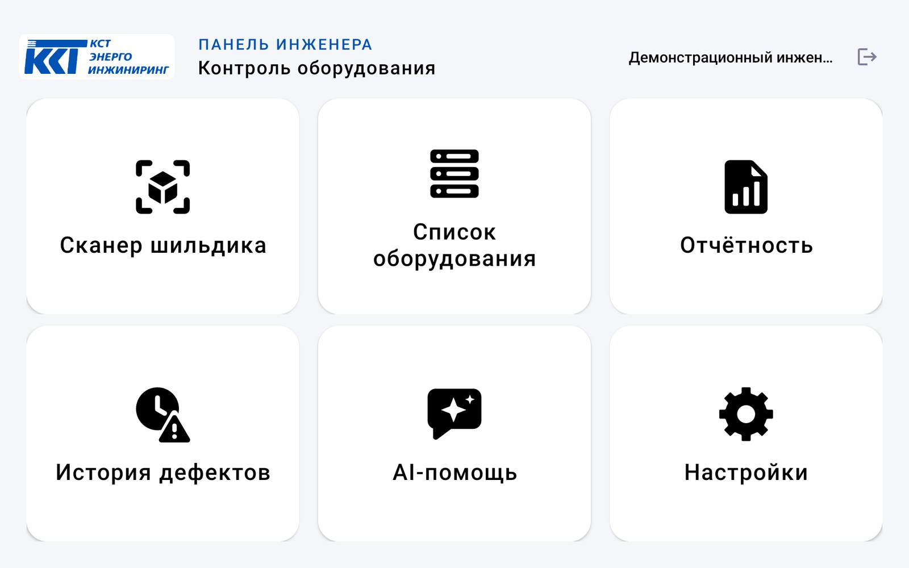
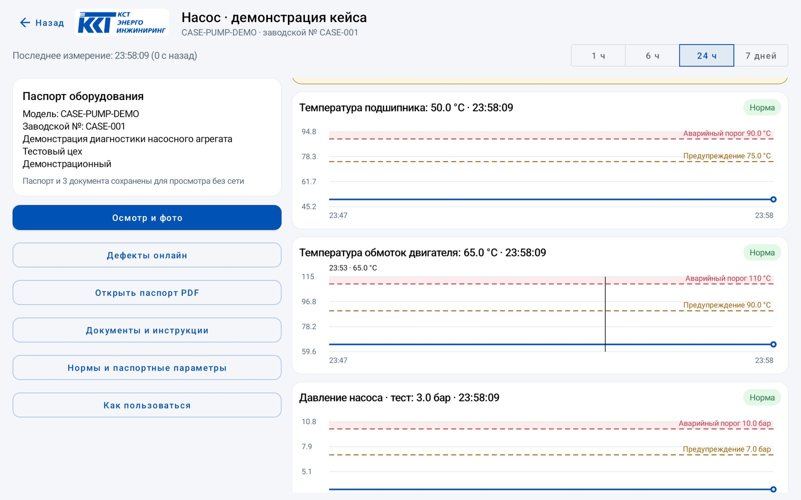
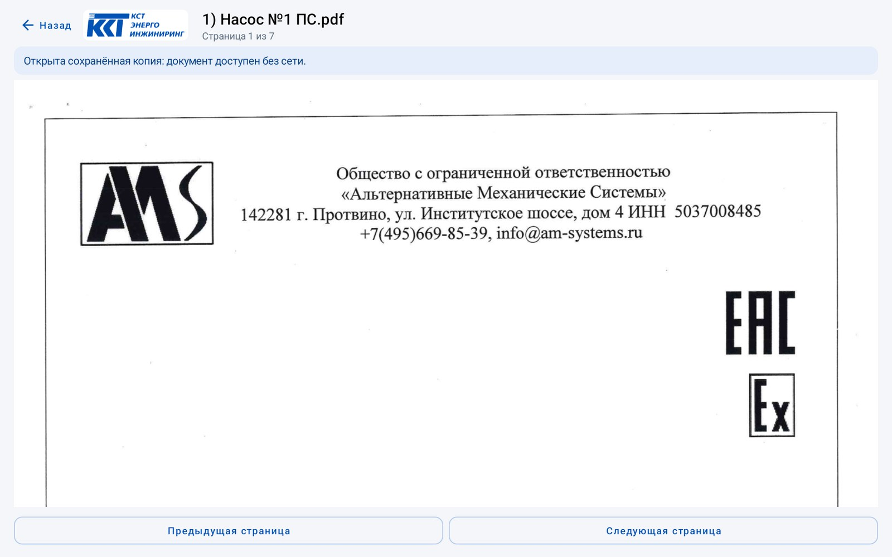
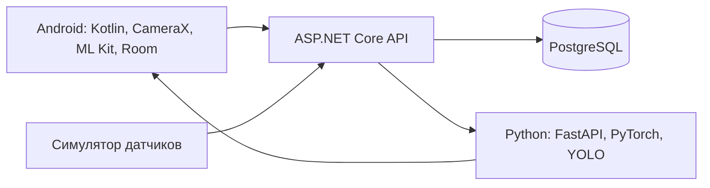

# КСТ Энерго · Fork

Планшетное приложение для осмотра насосного оборудования: OCR шильдика, паспорт и документы, графики датчиков, живой анализ камеры и история осмотров.



## Возможности

- Распознавание модели и заводского номера с камеры, подтверждение оборудования и ручной ввод.
- Паспорт PDF, инструкции, нормы и сохранённые документы для просмотра без сети.
- Температура, давление и вибрация: история, графики и предупреждения.
- Живой анализ камеры и фотографий. Настоящие контуры для сегментационных моделей, рамки для детекторов.
- Подтверждение, отклонение или исправление результата инженером; сохранение осмотра и PDF-отчёта.
- Вход по PIN, роли инженера и администратора, назначение доступа к оборудованию.
- Консоль и веб-панель тестовых датчиков с нагревом, давлением и вибрацией.

QR-коды в Android убраны. Основной экран открывается без анимированной заставки.

## Карточка насоса и графики



## Паспорт PDF



Снимки демонстрируют новый интерфейс планшета. Они не являются оценкой точности модели.

## Архитектура



## Запуск

Требования: Linux, .NET SDK 10, Python 3.12 и uv, PostgreSQL с initdb/pg_ctl/psql/createdb в PATH. Для Android: JDK 21 и SDK 36.1.

Материалы демонстрационного кейса: https://disk.yandex.ru/d/CaiCoW791_PlJA — распакуйте в CaseFiles/ с сохранением структуры. Веса поставляются отдельно от Git; каталог и SHA-256 находятся в ComputerVision/models/catalog.json.

```bash
./Setup-Project.sh
./Start-Integrated.sh
```

Для веб-панели и телеметрии в отдельных терминалах:

```bash
ComputerVision/.venv/bin/python ComputerVision/preview_server.py
./Sensor-Console.sh
```

API: http://127.0.0.1:5081 · CV: http://127.0.0.1:8001/health · Датчики: http://127.0.0.1:5099/sensors

Локальная конфигурация и демонстрационные аккаунты создаются в .integration/ и не входят в репозиторий. Для активного профиля скопируйте ComputerVision/model-selection.example.json в ComputerVision/model-selection.local.json после установки весов.

Сборка APK после настройки JAVA_HOME и ANDROID_HOME:

```bash
cd RepairHack
./gradlew assembleDebug -PapiBaseUrl=http://127.0.0.1:5081
```

Для планшета по USB:

```bash
adb reverse tcp:5081 tcp:5081
adb install -r KST-Energo-Android.apk
```

[Тестовый шильдик](docs/images/nameplate.png): CASE-PUMP-DEMO, номер CASE-001. Откройте на компьютере и сканируйте планшетом.

## Модели и ограничения

Зарегистрированы 11 моделей. Активный профиль: oil, oil_trained, metal, case_pilot, crack. Выполнено дообучение на Crack-Seg, Oil Leak Detection, коррозии, повреждениях лопастей и подтверждённых пользовательских фото.

Точность на насосах остаётся экспериментальной. Процент модели не является вероятностью поломки. Жидкость возвращается по маске с независимым подтверждением другой моделью; фильтр может пропускать реальные следы. Отсутствие отметок не подтверждает исправность. Результат проверяет инженер. Старые сохранённые анализы сохраняют свою геометрию; для новых контуров повторите анализ.

## Состав

- RepairHack/ — актуальное Android-приложение.
- BackendFork/ — API, доступ, документы, осмотры и отчёты.
- ComputerVision/ — CV, каталог моделей и проверка фотографий.
- database/ — схема и миграции PostgreSQL.
- scripts/ — запуск, установка, симулятор и подготовка обучения.
- AiYolo/ — инструменты разметки и обучения.
- tests/ — серверные проверки.
- docs/images/ — реальные экраны приложения и тестовый шильдик.

Локальные базы, кэши, веса, большие датасеты и дубли старого Android-проекта исключены из Git. Необязательная галерея разметки поставляется отдельно; сервис может анализировать новые фотографии без неё.

Android assembleDebug и lintDebug прошли, ошибок NewApi нет. API собран без ошибок. APK установлен на физический планшет Android 10; текущую ручную проверку выполняет команда Fork.
