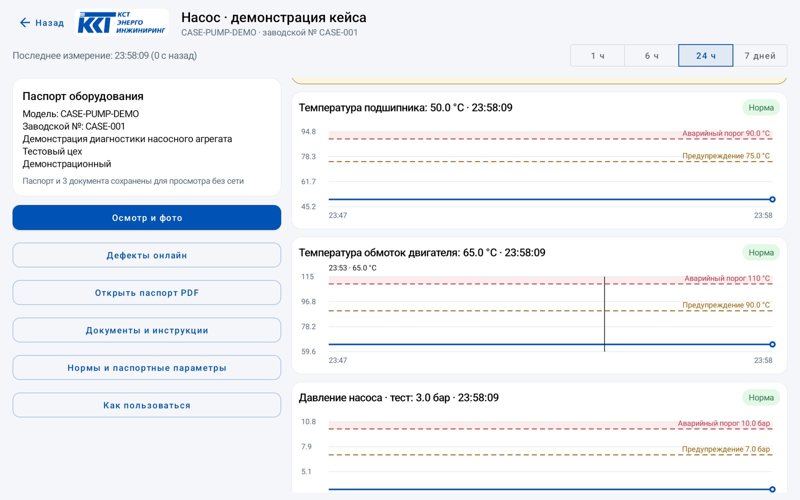

# 🥈 Fork — второе место на «Кибер102.РФ»

Мы заняли **второе место** с решением для КСТ Энерго. За эти пару дней отдельные части проекта сошлись в рабочий маршрут: вход на планшете, поиск оборудования, паспорт, осмотр поверхности, показания и сохранённый результат.

Для нас особенно важно, что на защите можно было открыть приложение и пройти этот маршрут руками. Камера, документы, анализ и серверные данные стали частью одного решения.

## Что мы успели сделать

- Подготовили нативное Android-приложение на **Kotlin** и обновили интерфейс под стиль Fork. Убрали анимированную заставку, чтобы сразу переходить к работе.
- Реализовали вход по PIN, роли инженера и администратора, поиск оборудования и доступ к конкретным агрегатам.
- Подключили распознавание текста шильдика через **Google ML Kit**: модель и заводской номер приводят к карточке оборудования. Для показа использовали CASE-001.
- Собрали паспорт, PDF-документы, инструкции и нормативные параметры рядом с агрегатом. Сохранённые документы доступны для повторного просмотра без сети.
- Связали приложение с **API на C# / ASP.NET Core и PostgreSQL**: показания, история, осмотры и отчёты хранятся у оборудования.
- Подготовили **симулятор температуры, давления и вибрации**. Изменение тестовых показаний на компьютере отображается в карточке и графиках на планшете.
- Подключили анализ фотографий и кадров камеры через **Python, FastAPI, PyTorch и YOLO**. Инженер может зафиксировать кадр, проверить предложенные области, подтвердить, отклонить или исправить результат.
- Добавили сохранение осмотра, комментарий инженера, повторный просмотр истории и PDF-отчёт.
- Подготовили отдельную **интерактивную браузерную презентацию**: вращение и разборка 3D-насоса, манометр, коррозия, течь масла, перегрев, дым и контуры поверхности. Опубликовали её на GitHub Pages.

## Как работали с моделями

Использовали готовые архитектуры и открытые веса, затем дообучали специализированные модели под задачи осмотра. Работали с **Crack-Seg, наборами Roboflow и собственной разметкой** насосов, труб и металлических деталей. Собирали доступные фотографии реального оборудования и поверхностей в помещениях и на открытом воздухе.

В каталоге проекта зарегистрированы **11 моделей и версий**. Подготовленные наборы включают тысячи изображений: например, набор коррозии содержит 2656 примеров, а Crack-Seg — 4028. Модели решают разные задачи: трещины, коррозия, следы масла и повреждения поверхностей.

Найденная область проходит проверку инженером. Такой порядок позволяет связать результат анализа с его заключением и сохранить осмотр у конкретного агрегата.

## Что запомнилось больше всего

Самые сильные моменты были в простых действиях. Меняем температуру на компьютере — видим новое показание на планшете. Сканируем шильдик — открываем нужную карточку. Выбираем фотографию, подтверждаем заключение — получаем запись в истории. Именно в такие моменты было видно, как части системы работают вместе.

Дни получились плотными: разметка, обучение, работа с интерфейсом, установка на реальный планшет, документы и подготовка защиты. Приходилось быстро переключаться между задачами и держать в голове весь маршрут пользователя. Больше всего внимания уделили тому, чтобы этот маршрут можно было показать последовательно на одном устройстве.

Второе место — приятный итог этой работы. Мы гордимся тем, сколько удалось собрать за короткое время, и тем, что решение можно было продемонстрировать в действии. Этот репозиторий сохраняет результат нашей команды и опыт этих дней.

Спасибо команде, организаторам и жюри за «Кибер102.РФ»!

## Где посмотреть результат

- [Основной проект и инструкции запуска](../README.md).
- [Онлайн-презентация Fork](https://ta1ryn.github.io/Fork-Presentation/).
- [Исходники интерактивной презентации](https://github.com/Ta1Ryn/Fork-Presentation).

В браузерной презентации используются интерактивные сценарии, тестовая телеметрия и подготовленные вручную контуры фотографий. Живое Android-приложение демонстрировалось отдельно на планшете.
